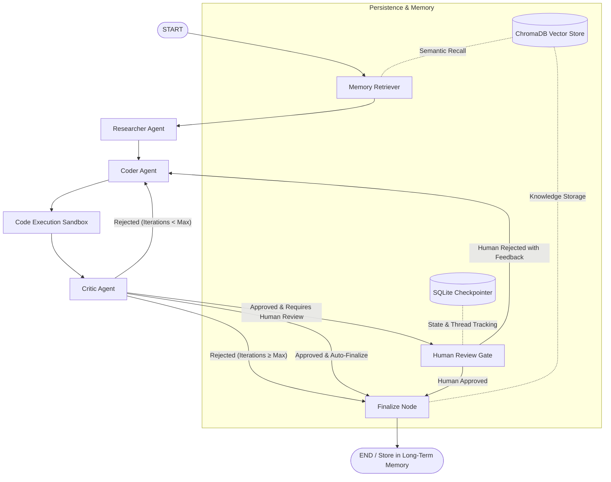

# Multi-Agent Autonomous Workflow Orchestrator

[](https://github.com/himanshu-787/multi-agent-workflow-engine/actions)
[](https://www.python.org/downloads/)
[](https://github.com/langchain-ai/langgraph)
[](https://fastapi.tiangolo.com)
[](https://www.trychroma.com/)
[](LICENSE)

An enterprise-ready, stateful, cyclic multi-agent autonomous workflow orchestrator built with **LangGraph**, **FastAPI**, and **ChromaDB**. Features intelligent self-correction loops, Pydantic-validated tool sandboxes, persistent SQLite checkpointing, human-in-the-loop (HITL) approval gates, and long-term semantic memory.

---

## 🏗️ Architecture Overview

The orchestrator executes a cyclic multi-agent state graph where specialized agents collaborate, execute tools, evaluate outputs, and self-correct until strict criteria are met or human approval is granted.



### Agent Roles

1. **Researcher Agent**: Analyzes high-level tasks, queries long-term ChromaDB vector memory for past successful implementations, identifies edge cases, and drafts technical specifications.
2. **Coder Agent**: Implements runnable, robust Python code adhering to research notes and incorporates any feedback or error logs from previous iterations.
3. **Execution Sandbox**: Executes generated code in an isolated subprocess with strict timeouts, capturing `stdout`, `stderr`, and execution return codes.
4. **Critic Agent**: Validates code and execution traces against requirements using structured Pydantic verdicts (`CriticVerdict`). Rejection deterministically routes execution back to the Coder.
5. **Human-in-the-Loop Gate**: Checkpoints workflow state and pauses execution, enabling human operators to inspect generated code and approve or reject with custom feedback.

---

## 🚀 Roadmap & Implementation Status

| Phase | Description | Status |
|---|---|:---:|
| **0** | Project setup, folder structure, Git initial commit & GitHub push | ✅ Complete |
| **1** | Configuration with Pydantic Settings, shared state schema, skeleton graph, health API | ✅ Complete |
| **2** | Real LLM agents (Researcher, Coder, Critic) with conditional cyclic feedback loop | ✅ Complete |
| **3** | Tool registry with strict Pydantic validation & safe subprocess code execution | ✅ Complete |
| **4** | Checkpointing with `SqliteSaver` & human-in-the-loop (HITL) pause/resume gates | ✅ Complete |
| **5** | ChromaDB long-term memory store & semantic context recall for past runs | ✅ Complete |
| **6** | Async FastAPI endpoints (`/workflows`, `/memory`, `/tools`) & lifecycle management | ✅ Complete |
| **7** | Production Docker container, docker-compose, CI workflow, and full test suite | ✅ Complete |

---

## 🛠️ Tool Registry & Security Safeguards

Every tool is strictly typed and validated using Pydantic schemas before invocation:

- **`code_executor`**: Executes Python code in an isolated subprocess with configurable timeout (1–30s) and captures stdout/stderr.
- **`calculator`**: Safe mathematical expression evaluation using Python Abstract Syntax Trees (AST) with zero `eval()` vulnerabilities.
- **`file_reader` / `file_writer`**: Workspace-sandboxed file I/O with automatic path traversal prevention (`../` detection).
- **`web_search`**: Technical documentation search with offline knowledge-base fallback.

---

## ⚡ Quickstart

### Prerequisites
- Python 3.11+
- Git

### 1. Clone & Set Up Virtual Environment

```bash
git clone https://github.com/himanshu-787/multi-agent-workflow-engine.git
cd multi-agent-workflow-engine

# Windows PowerShell
python -m venv .venv
.venv\Scripts\Activate.ps1

# Linux / macOS
python -m venv .venv
source .venv/bin/activate
```

### 2. Install Dependencies

```bash
pip install -r requirements.txt
```

### 3. Configure Environment

Copy `.env.example` to `.env` and set your credentials:

```bash
cp .env.example .env
```

```env
OPENAI_API_KEY=your-api-key-here
MODEL_NAME=gpt-4o-mini
ENVIRONMENT=dev
MAX_CRITIC_ITERATIONS=3
CHROMA_PATH=./data/chroma
CHECKPOINT_DB=./data/checkpoints.sqlite
```

> **Note**: Compatible with OpenAI, Groq (`gsk_...`), xAI, Anthropic, or local Ollama endpoints.

---

## 🖥️ Running the Application

### Option A: Interactive CLI Demo

Stream the multi-agent execution live in your console:

```bash
python -m app.cli "Write an efficient function to compute the n-th Fibonacci number"
```

### Option B: FastAPI Server

Start the REST API server with hot-reload:

```bash
uvicorn app.main:app --reload --host 127.0.0.1 --port 8000
```

- **Interactive API Docs (Swagger UI)**: [http://127.0.0.1:8000/docs](http://127.0.0.1:8000/docs)
- **Alternative Docs (ReDoc)**: [http://127.0.0.1:8000/redoc](http://127.0.0.1:8000/redoc)
- **Health Check**: [http://127.0.0.1:8000/health](http://127.0.0.1:8000/health)

### Option C: Docker & Docker Compose

Run the entire stack in isolated Docker containers:

```bash
docker compose up --build -d
```

---

## 📡 API Reference

### 1. Workflows

#### Start a Workflow
```http
POST /workflows
Content-Type: application/json

{
  "task": "Write a Python function to validate email addresses with regex",
  "require_human_approval": true,
  "max_critic_iterations": 3,
  "enable_tools": true,
  "enable_memory": true
}
```

*Response (200 OK):*
```json
{
  "thread_id": "7648f5a1-7785-4dbb-8288-ff8f8251e604",
  "status": "pending_human_review",
  "next_step": "human_review",
  "message": "Workflow paused at human approval gate."
}
```

#### Get Workflow Status
```http
GET /workflows/7648f5a1-7785-4dbb-8288-ff8f8251e604
```

*Response (200 OK):*
```json
{
  "thread_id": "7648f5a1-7785-4dbb-8288-ff8f8251e604",
  "status": "pending_human_review",
  "next_step": "human_review",
  "task": "Write a Python function to validate email addresses with regex",
  "code": "import re\n\ndef validate_email(email: str) -> bool:\n    pattern = r'^[a-zA-Z0-9_.+-]+@[a-zA-Z0-9-]+\\.[a-zA-Z0-9-.]+$'\n    return bool(re.match(pattern, email))",
  "critique": "Approved: Valid regex and edge case handling.",
  "execution_result": "[SUCCESS] Output:\nCode executed successfully with no output.",
  "iterations": 1
}
```

#### Submit Human Review (Approve / Reject)
```http
POST /workflows/7648f5a1-7785-4dbb-8288-ff8f8251e604/approve
Content-Type: application/json

{
  "approved": true,
  "feedback": "Code is approved for deployment."
}
```

### 2. Memory & Tools

- **Search Vector Memory**: `GET /memory/search?q=fibonacci&limit=3`
- **Execute Tool Directly**:
  ```http
  POST /tools/execute
  Content-Type: application/json

  {
    "tool_name": "calculator",
    "arguments": { "expression": "2 ** 10 + 48" }
  }
  ```

---

## 🧪 Testing Suite

The repository features comprehensive offline unit and integration tests covering all 7 phases:

```bash
pytest -v
```

All 29 tests run deterministically with simulated LLMs and offline embeddings, requiring zero external API calls or network connections.

---

## 📂 Repository Structure

```
multi-agent-workflow-engine/
├── .github/
│   └── workflows/
│       └── ci.yml               # GitHub Actions CI pipeline
├── app/
│   ├── agents/
│   │   ├── coder.py             # Coder agent implementation
│   │   ├── critic.py            # Critic agent with structured verdict
│   │   ├── executor.py          # Safe subprocess code execution node
│   │   ├── llm.py               # Configurable LLM factory
│   │   ├── prompts.py           # System prompts
│   │   ├── researcher.py        # Researcher agent with memory integration
│   │   ├── schemas.py           # CriticVerdict and data models
│   │   └── utils.py             # Code-fence extraction utilities
│   ├── api/
│   │   ├── models.py            # Pydantic request/response schemas
│   │   ├── routes.py            # FastAPI REST endpoints
│   │   └── service.py           # Workflow orchestration service
│   ├── graph/
│   │   ├── builder.py           # LangGraph StateGraph builder with cyclic loop
│   │   └── state.py             # Shared WorkflowState TypedDict
│   ├── hitl/
│   │   └── approval.py          # Human-in-the-loop review nodes & schemas
│   ├── memory/
│   │   ├── embedding.py         # Deterministic offline vector embedding
│   │   └── store.py             # ChromaDB persistent memory client
│   ├── persistence/
│   │   └── checkpointer.py      # SQLite & MemorySaver checkpoint managers
│   ├── tools/
│   │   ├── base.py              # BaseToolWrapper and ToolResult
│   │   ├── calculator.py        # Safe AST arithmetic evaluator
│   │   ├── code_executor.py     # Subprocess Python execution tool
│   │   ├── file_tools.py        # Sandboxed file reader/writer
│   │   ├── registry.py          # Central ToolRegistry with schema validation
│   │   └── search.py            # Technical search & knowledge base
│   ├── cli.py                   # Live streaming CLI demo
│   ├── config.py                # Pydantic Settings configuration
│   └── main.py                  # FastAPI application entrypoint
├── docker/
│   └── Dockerfile               # Multi-stage production container
├── tests/
│   ├── fakes.py                 # Scripted FakeLLM for deterministic tests
│   ├── test_api.py              # Health check endpoint tests
│   ├── test_api_endpoints.py    # Complete FastAPI lifecycle tests
│   ├── test_graph.py            # LangGraph cyclic routing & loop tests
│   ├── test_hitl.py             # Checkpointing & HITL pause/resume tests
│   ├── test_memory.py           # ChromaDB memory store & recall tests
│   └── test_tools.py            # Tool execution & validation tests
├── .dockerignore
├── .env.example
├── .gitignore
├── docker-compose.yml
├── pytest.ini
├── README.md
└── requirements.txt
```

---

## 📜 License

Distributed under the MIT License. See `LICENSE` for more information.
